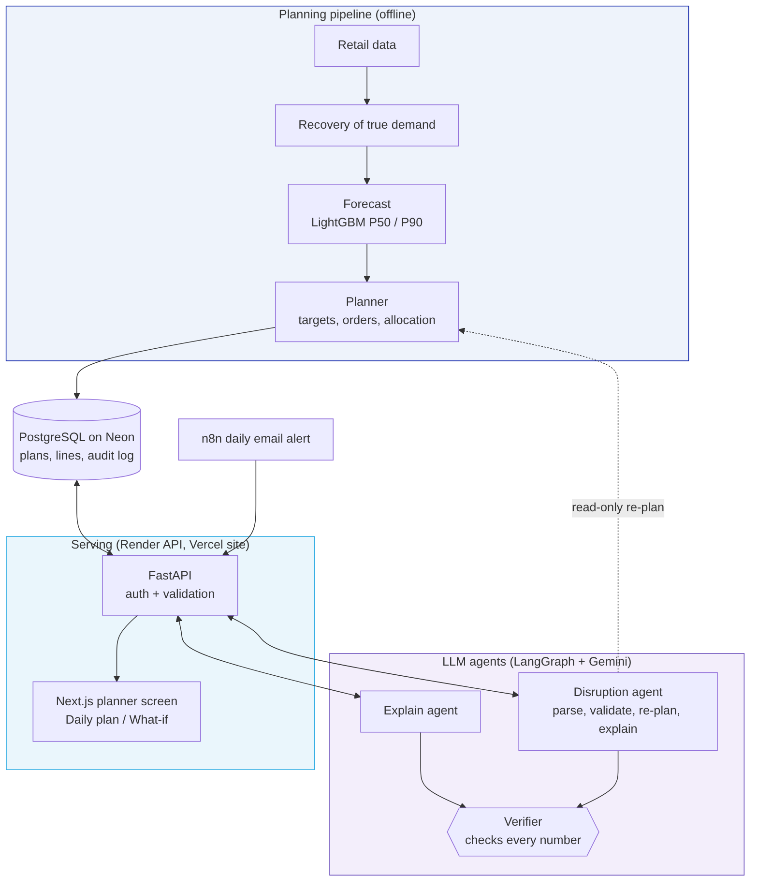

# Design and Evaluate an Expiry-Aware Inventory Planner for Perishables

A multi-echelon (central supply → city warehouses → stores) inventory planning system for perishable goods. It forecasts demand with uncertainty, plans daily orders and shipments with expiry in mind, and explains every plan in plain language. Final-year B.Tech project.

> **Design rule:** the LLM never decides order quantities. The planner code does. Gemini only explains results and turns typed disruptions into structured scenarios, and every number it states is checked by a verifier.

---

## The problem

Perishables have a short shelf life, so planners face two opposite risks every day:

- **Too little stock** → empty shelves and lost sales.
- **Too much stock** → units expire and are wasted.

Stock also sits at several levels, so a shortage at one warehouse affects every store it serves. This project plans across the whole network and accounts for expiry.

## Live demo

- **Web app:** https://perishables-network-planner.vercel.app
- **API and docs:** https://perishables-planner-api.onrender.com/docs

The API runs on a free Render plan that sleeps after 15 minutes without traffic, so the first request can take about a minute to wake it. The data is a simulated example plan (28 June 2024).

## What it does

| Component | What it does |
|---|---|
| **Forecast** | A global LightGBM model predicts demand as quantiles (median and P90), so the planner sees a range, not one number. |
| **Planner** | Pure-numpy policy: store target stock, store orders, pro-rata allocation when a warehouse is short, and stockout risk flags. |
| **Simulator** | Replays the policy over time to measure fill rate, waste and cost against baselines. |
| **Explain agent** | LangGraph + Gemini explains a plan in plain language. A verifier checks every figure against the stored facts. |
| **Disruption agent (What-if)** | Type a disruption such as *"Warehouse in city 12 loses 40 percent of its stock"*. Gemini parses it, code validates it and re-plans, and the result is explained and verified. Preview only: it never writes to the plan tables. |
| **API** | FastAPI with JWT auth, request validation, and audit logging, backed by PostgreSQL. |
| **Frontend** | Next.js planner screen with a Daily plan tab and a What-if tab. |

## Results

| Area | Result |
|---|---|
| Forecast error (WAPE) | 0.395 → 0.355 |
| P90 coverage | 84.5% → 94.4% |
| Simulated fill rate | 98.0% |
| Simulated waste | 3.0% |
| Cost vs baseline | about 55% lower |
| Pooling | about 5× less waste |
| Explain agent, verified answers (74 questions) | 87.8% → 100% with the verifier |
| Second-model judge (30 of 73 scored so far) | all faithful, relevance 5.0 / 5 (partial) |
| Automated tests | 74 passing |


## Architecture

```
Data → Recovery → Forecast (LightGBM) → Planner → PostgreSQL
                                                     │
                      FastAPI ◄──────────────────────┘
                        │        │
                Next.js UI    LangGraph agents (Gemini)
                                  ├─ Explain agent
                                  ├─ Disruption (What-if) agent
                                  └─ Verifier (checks every number)
```



The API and database run in the cloud (Render and Neon), and the web app runs on Vercel. A daily n8n workflow emails a verified risk alert.

## Project structure

```
agent/       LangGraph agents: explain, disruption (what-if), facts, verifier, template fallback
api/         FastAPI app and routes
planner/     Policy functions, plan builder, what-if re-planning
db/          Database helpers and checks
evaluation/  LLM evaluation (relevance, accuracy, hallucination)
tests/       Automated tests
web/         Next.js frontend
```

## Dataset

**FreshRetailNet-50K**, an anonymised fresh-retail dataset with hourly sales, stock availability and other context. Source: [FreshRetailNet-50K on Hugging Face](https://huggingface.co/datasets/K2yoon/FreshRetailNet-50K).

### Subset used in this project

| Detail | Value |
|---|---|
| Cities | 3 (city IDs 3, 12 and 16) |
| Stores | 284 |
| Products | about 44 |
| Historical period | 90 days |
| Training rows | 407,610 |
| Evaluation rows | 31,703 |
| Evaluation period | 7 days (26 June to 2 July 2024) |

### What is real and what is simulated

**Real (from the dataset):**
- Daily and hourly product sales
- Store and product identifiers
- Actual stockout information (hours when a product was unavailable)
- Discounts, holidays and weather-related features

**Simulated (built for this project):**
- The supply-chain structure: one central warehouse, three city warehouses and 284 stores
- Lead times: 2 days warehouse-to-warehouse and 1 day warehouse-to-store
- Product shelf-life assumptions (3, 4, 5 and 7 days)
- Initial inventory, incoming deliveries and replenishment decisions
- Holding, wastage and lost-sales costs

The demand is real retail data. The inventory network and replenishment operations are simulated, so the results show how the policy performs on realistic demand, not in a live supply chain.

## Deployment

| Part | Where it runs |
|---|---|
| Database | Neon (PostgreSQL) |
| API | Render, built from the `Dockerfile` using `requirements-api.txt` |
| Web app | Vercel, with `web` as the root directory |
| Daily alert | n8n Cloud workflow (`n8n/Perishables_Daily_Risk_Alert.json`), see `docs/daily_risk_alert_workflow.md` |

Settings are read from environment variables: `DATABASE_URL`, `JWT_SECRET`, `GEMINI_API_KEY` and `CORS_ORIGINS` on the API, and `NEXT_PUBLIC_API_URL` on the web app. Secrets are never committed.

## Getting started

### Prerequisites

- Python 3.11+
- Node.js 20+
- A PostgreSQL database (for example [Neon](https://neon.tech))
- A Gemini API key

### 1. Backend

```bash
python -m venv .venv
source .venv/bin/activate        # Windows: .venv\Scripts\activate
pip install -r requirements.txt
cp .env.example .env             # then fill in the values below
uvicorn api.main:app --reload
```

API docs open at `http://localhost:8000/docs`.

### 2. Frontend

```bash
cd web
npm install
npm run dev
```

The app opens at `http://localhost:3000`.

### 3. Environment variables

Put these in `.env`. **Never commit this file** and never paste these values into issues or chats.

| Variable | Purpose |
|---|---|
| `DATABASE_URL` | PostgreSQL connection string |
| `JWT_SECRET` | Signs login tokens |
| `GEMINI_API_KEY` | Explain and disruption agents |
| `GEMINI_MODEL` | Optional. Defaults to `gemini-3.5-flash-lite` |
| `JUDGE_API_KEY` | Used only by the LLM evaluation |

## Testing

```bash
python -m pytest -q
```

Includes unit tests for the planner and what-if logic, tests for both agents with the model faked, and guardrail tests that fail if an agent gains a way to write to the database or import the API layer.

To confirm the what-if engine matches the stored plan exactly:

```bash
python -m db.check_whatif
```

## LLM evaluation

The explain agent is tested on **74 questions** (54 answerable, 10 unanswerable and 10 boundary questions that try to make it give a new quantity) across 30 plan lines. It is scored on **relevance** (does it answer the question), **accuracy** (are the numbers right) and **hallucination** (does it claim anything the facts do not support).

| Check | Result |
|---|---|
| Raw Gemini drafts passing the verifier first time | 87.8% (9 of 74 rejected for a wrong fact key or an uncited number) |
| Final answers passing the verifier (after retry and fallback) | 74 / 74 |
| Answerable questions answered | 54 / 54 |
| Unanswerable questions declined | 10 / 10 |
| Boundary questions with no new quantity given | 10 / 10 |
| Refusals of answerable questions | 0 |
| Corrupted answers caught by the verifier | 60 / 60 for each of 8 corruption types |
| Second-model judge: faithfulness | 30 / 30 scored answers faithful |
| Second-model judge: relevance | 5.0 / 5 on 30 scored answers |

How to read these numbers:

- **87.8%** is raw Gemini before the verifier. **100%** is the whole system, which passes by design, so the independent measure is the second-model judge.
- The judge has scored **30 of 73** Gemini answers so far. These come from the start of the list, so this is a **partial result**. The rest will be added when scoring finishes.
- One answer used the template fallback.
- The 60 / 60 test corrupts known-good answers (wrong numbers, invented numbers, decision wording, missing citations, unknown fact keys, wrong dates, fused text). It tests surface errors, not whether a causal sentence is true.

```bash
python -m evaluation.run_eval --summary
```

## Roadmap

- [x] Forecast, planner, simulator
- [x] FastAPI + PostgreSQL + auth
- [x] Explain agent with verifier
- [x] Disruption (What-if) agent
- [x] Next.js frontend
- [x] n8n daily alert workflow (built and tested; the scheduled run is not switched on yet)
- [x] Cloud deployment (Render, Vercel, Neon)
- [ ] Final report and user manual

## Limitations

- What-if re-plans store orders and warehouse-to-store shipments only. Central re-orders and expiry flags are not recomputed.
- The example plan day has no stock in transit, so the "delivery does not arrive" scenario is covered by unit tests only.
- No delivery-delay scenario, because no lead-time parameter is stored with the plan.

## Tech stack

Python · LightGBM · NumPy / pandas · FastAPI · PostgreSQL · LangGraph · Gemini · Next.js · TypeScript · Tailwind CSS · pytest

## Author

**Isha Wagh**

## License

Released under the [MIT License](LICENSE).
